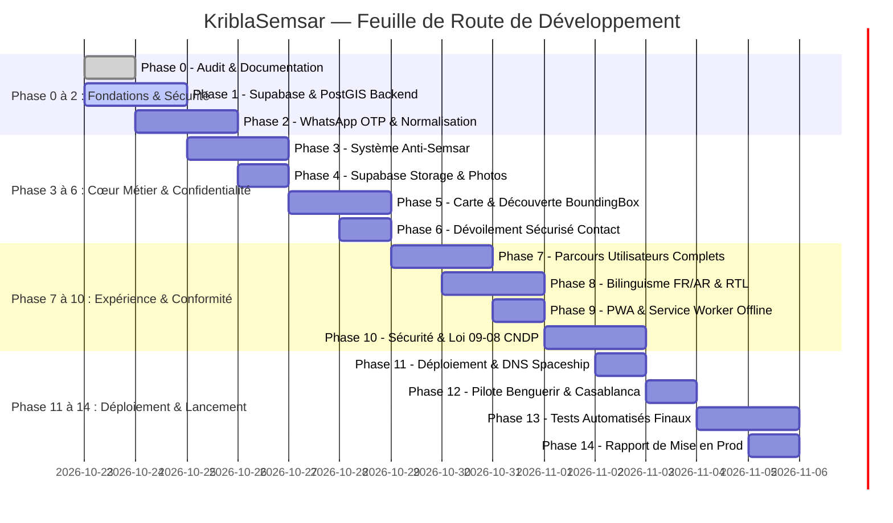

# KriblaSemsar — Plan d'Implémentation Détaillé (docs/IMPLEMENTATION_PLAN.md)

**Projet :** KriblaSemsar (`kriblasemsar.com`)  
**Objectif :** Transformer le prototype pilote en plateforme de colocation et location marocaine de production, 100% directe (« 0% Semsar »), sécurisée, PWA, et évolutive à l'échelle nationale.

---

## 1. Calendrier des Phases et Jalons de Développement

---

## 2. Détail Exécutif par Phase

### Phase 0 — Audit Complet et Documentation de Base
- [x] Inspection exhaustive de la base de code existante (React 18 + Vite + Leaflet).
- [x] Établissement des documents architecturaux et de sécurité obligatoires :
  - `docs/PROJECT_AUDIT.md`
  - `docs/ARCHITECTURE.md`
  - `docs/IMPLEMENTATION_PLAN.md`
  - `docs/SECURITY_CHECKLIST.md`
  - `docs/DEPLOYMENT.md`
  - `docs/IMPLEMENTATION_PROGRESS.md`
- [x] Initialisation du dépôt Git pour garantir des commits réguliers aux points d'étape stables.

### Phase 1 — Architecture Backend Supabase & PostGIS
- [ ] Création du dossier de migrations ordonnées `supabase/migrations/`.
- [ ] Migration 001 : Extension PostGIS, tables `profiles`, `cities`, `listings`, `listing_photos`, `seeker_profiles`, `favorites`, `listing_reports`, `contact_events`, `phone_verifications`, `audit_logs`.
- [ ] Création des index spatiaux GiST sur `geography(Point, 4326)`.
- [ ] Fonctions PL/pgSQL : `get_listings_in_bbox()`, `get_listings_nearby()`.
- [ ] Déploiement de Row Level Security (RLS) sur 100% des tables exposées.
- [ ] Génération des types TypeScript `src/types/database.types.ts`.

### Phase 2 — Normalisation Téléphonique et Vérification OTP WhatsApp (+212)
- [ ] Parser de numéros de téléphone marocains (`+212 6...`, `+212 7...`, `06...`, `07...`) au format standard E.164.
- [ ] Module d'abstraction fournisseur OTP (`src/services/verification/`) :
  - Interface fournisseur unifiée.
  - Implémentation Mock pour les tests de développement sans frais.
  - Implémentation WhatsApp Cloud API / Twilio Verify.
  - Implémentation de repli (fallback) par SMS.
- [ ] Système anti-abus : Cooldown de 5 minutes, limitation de 3 essais par code, protection contre le trafic pumping.
- [ ] Endpoint serveur sécurisé de validation d'OTP qui met à jour `phone_verified_at` via trigger/fonction sécurisée.

### Phase 3 — Système Anti-Semsar & Détection de Fraude
- [ ] Composant modal de déclaration sur l'honneur lors de la publication d'annonce (0% commission, direct propriétaire ou colocataire).
- [ ] Signaux d'alerte automatisés (comptes multiples partageant le même numéro ou les mêmes photos).
- [ ] Mise en quarantaine automatique des annonces ayant reçu 3 signalements motivés.
- [ ] Console d'administration pour modération humaine des annonces en attente (`pending_review`).

### Phase 4 — Stockage Sécurisé Supabase & Optimisation d'Images
- [ ] Configuration des buckets Supabase Storage : `listing-photos` (public avec CDN) et `verification-documents` (strictement privé).
- [ ] Utilitaire de compression côté client avant téléversement (redimensionnement max 1600px, conversion WebP, suppression EXIF).
- [ ] Politiques RLS sur le storage assurant que seul le propriétaire peut supprimer ses photos.

### Phase 5 — Moteur Cartographique & Découverte Géographique
- [ ] Connexion de `InteractiveMap.tsx` à la fonction PostGIS `get_listings_in_bbox()`.
- [ ] Debounce de 300ms sur les déplacements de carte (`moveend`) pour minimiser les requêtes.
- [ ] Préservation du Spiderfier pour les annonces partageant la même position.
- [ ] Respect de la zone de discrétion (cercle de 200m) pour les adresses privées.

### Phase 6 — Dévoilement Sécurisé des Coordonnées (Contact Flow)
- [ ] Fonction RPC sécurisée `reveal_contact_info(listing_id)`.
- [ ] Vérification stricte côté serveur : utilisateur connecté + numéro vérifié.
- [ ] Rate limit strict (max 10 contacts révélés par 24h par utilisateur).
- [ ] Génération dynamique du lien officiel `https://wa.me/212...` avec message contextualisé bilingue.
- [ ] Fenêtre modale d'avertissement et respect des créneaux d'appel autorisés.

### Phase 7 — Expérience Utilisateur Complète (Parcours Rôles)
- [ ] Parcours Visiteur : Consultation carte, filtres, recherche instantanée.
- [ ] Parcours Locataire : Sauvegarde de favoris, profils de recherche colocation, contact direct.
- [ ] Parcours Bailleur / Colocataire sortant : Wizard de publication, gestion de disponibilité, marquage « Loué ».
- [ ] Parcours Administrateur : Revue des annonces, traitement des signalements semsar, consultation des journaux d'audit.

### Phase 8 — Bilinguisme Intégral Français / Arabe (RTL)
- [ ] Module d'internationalisation réactif (FR / AR).
- [ ] Inversion dynamique de mise en page avec `dir="rtl"` en Arabe.
- [ ] Vocabulaire local marocain adapté (Moul Dar, Coloc, Sans Semsar, Somme en DH).

### Phase 9 — PWA & Mode Hors-Ligne
- [ ] Enregistrement du Service Worker avec Workbox / Cache API.
- [ ] Stratégie de mise en cache : Stale-While-Revalidate pour les tuiles cartographiques statiques et les assets.
- [ ] **Sécurité PWA :** Exclusion formelle de la mise en cache des requêtes de contacts privés et des jetons JWT.
- [ ] Bannière d'installation PWA native sur Android et guide pas-à-pas pour iOS Safari.

### Phase 10 — Revue de Sécurité & Conformité Réglementaire Marocaine
- [ ] Validation complète des schémas d'entrée via Zod.
- [ ] Tests d'intrusion simulés (injections SQL via PostGIS, bypass RLS, IDOR).
- [ ] Analyse de conformité préliminaire avec la Loi marocaine 09-08 (protection des données à caractère personnel) et recommandations pour la CNDP.

### Phase 11 — Déploiement en Production
- [ ] Configuration DNS Spaceship pour `kriblasemsar.com` et `www.kriblasemsar.com`.
- [ ] Redirection canonique automatique vers HTTPS.
- [ ] Configuration des variables d'environnement de production.
- [ ] Pipeline CI/CD GitHub Actions / script de déploiement vérifiant `npm run build` et les tests RLS avant tout push en production.

### Phase 12 — Lancement Pilote (Benguerir & Casablanca)
- [ ] Pages d'atterrissage optimisées pour les étudiants et chercheurs UM6P à Benguerir.
- [ ] Pages d'atterrissage optimisées pour les jeunes actifs et entreprises à Casablanca (CFC, Casanearshore, Maârif).
- [ ] Tableau de bord analytique simple pour suivre l'activité réelle sans données fictives.

### Phase 13 — Tests Automatisés & Scénarios de Recette
- [ ] Tests de non-régression et scénarios bout-en-bout (Locataire, Propriétaire, Suspect Semsar, Utilisateur non autorisé).
- [ ] Validation de la résilience du service lors de pannes du fournisseur de messagerie.

### Phase 14 — Livrables Finaux & Rapport de Mise en Production
- [ ] Rédaction de `docs/PRODUCTION_READINESS_REPORT.md`.
- [ ] Mise à jour continue de `docs/IMPLEMENTATION_PROGRESS.md`.
